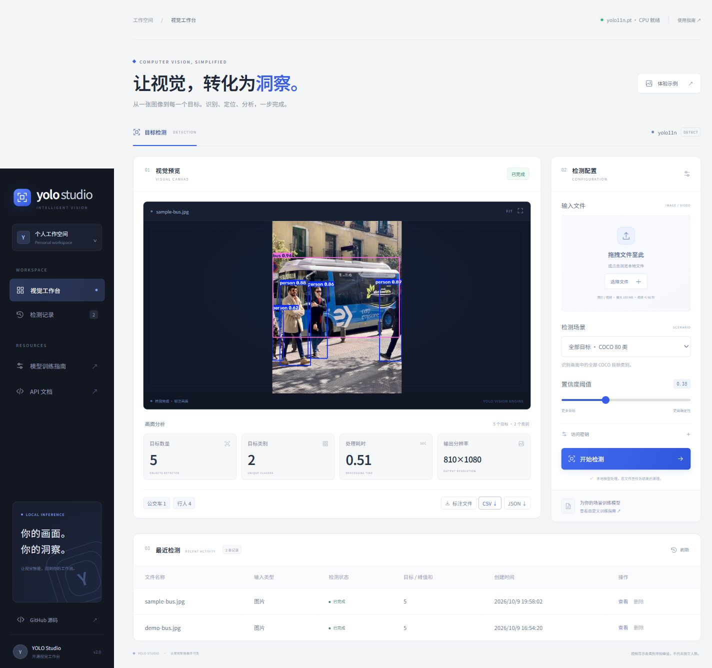
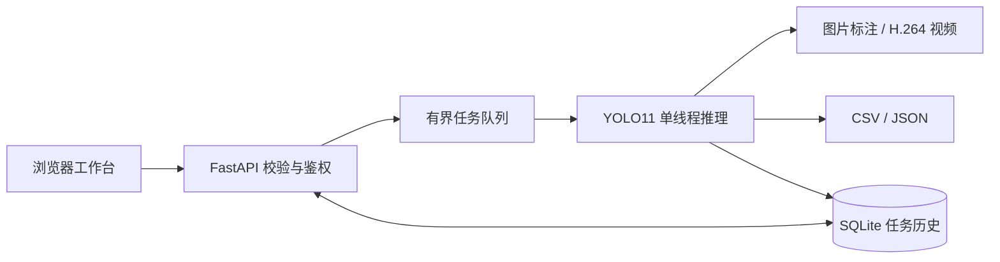

# YOLO Vision Studio · 智能视觉工作台

[](https://github.com/zhe177234-beep/yolo/actions/workflows/ci.yml)

把 YOLO 目标检测做成可运行、可展示、可扩展的完整项目：上传图片或视频，获得标注画面、分类统计与结构化检测结果。默认使用 **YOLO11n + COCO 80 类**，无需 GPU，也无需第三方推理 API。



## 已实现

- 中文响应式工作台，支持拖拽上传、阈值调整和检测历史。
- JPG / PNG / WebP 图片检测；MP4 / MOV / AVI 视频逐帧检测，输出 H.264 MP4。
- 全部目标、交通场景（行人/自行车/汽车/摩托车/公交车/卡车）、行人三种预设。
- 后台单线程模型推理、最多 8 个等待/执行任务、状态及进度轮询。
- 标注文件、逐目标 CSV、完整 JSON 导出；结果删除；SQLite 持久化。
- 自定义模型训练、验证、ONNX / TorchScript 导出脚本。
- 可选 API 密钥、100 MB 上传限制、60 秒视频限制和原始文件自动清理。
- Docker Compose 部署、GitHub Actions 单元测试、真实图片/视频推理和容器构建检查。

**统计定义：** 图片为单张目标数量。视频为“各类别在单帧中出现的最大数量”，各类别峰值可能来自不同画面；峰值之和不代表同一帧总数或独立人数。当前版本未实现跨帧跟踪或过线计数。视频导出不保留音轨。

## 快速启动

需要 Python 3.10 或 3.11。首次安装 PyTorch 和下载模型需要网络。默认模型在部署准备阶段下载，Web 请求不会替用户下载任意模型。

### Windows PowerShell

```powershell
git clone https://github.com/zhe177234-beep/yolo.git
cd yolo
powershell -ExecutionPolicy Bypass -File scripts/start.ps1
```

浏览器打开 **http://127.0.0.1:8000**；交互 API 文档为 **http://127.0.0.1:8000/docs**。

### Linux / macOS

```bash
python3 -m venv .venv
source .venv/bin/activate
pip install torch==2.6.0 torchvision==0.21.0 --index-url https://download.pytorch.org/whl/cpu
pip install -r requirements.txt
python scripts/setup_model.py
python -m uvicorn app.main:app --host 127.0.0.1 --port 8000
```

macOS 请省略 CPU 专用索引安装步骤，让 requirements.txt 安装平台可用的 PyTorch。

### Docker

```bash
docker compose up -d --build
```

同样访问 http://127.0.0.1:8000。镜像构建时下载权重，SQLite 与结果保存在 `yolo-data` 卷。容器默认以普通用户运行。

## 项目设计



前后端同源，前端使用原生 HTML/CSS/JavaScript，无 Node 构建步骤。模型单线程执行，避免同一实例并发推理冲突。服务重启后中断任务标记失败，需重新上传；已完成结果保留。此版本定位为个人演示、课程设计和单机小团队工具。

| 目录 | 用途 |
| --- | --- |
| `app/main.py` | API、文件上传、任务调度、下载与删除 |
| `app/engine.py` | 模型加载、图片/视频处理、导出 |
| `app/store.py` | SQLite 记录 |
| `app/static/` | 中文工作台 |
| `scripts/` | 安装模型、训练、真实推理验证、启动 |
| `datasets/custom.example.yaml` | 自定义数据集配置示例 |
| `tests/` | API 与导出行为测试 |
| `docs/` | 训练和部署指南 |

## 自定义训练

```bash
python scripts/train.py --data datasets/custom.yaml --epochs 50 --batch 8 --device cpu
```

将数据集按 YOLO 格式标注，修改示例 YAML 后使用。训练脚本会在训练结束后验证 `best.pt`；可附加 `--export onnx`。训练结果不等于已经适用于实际场景，需使用独立测试集评估。完整流程见 [训练指南](docs/TRAINING.md)。

## 配置与 API

配置通过进程环境变量读取。`.env.example` 为参考；Python 启动不会自动读取 `.env`，Docker Compose 会读取其中用于 Compose 插值的 `YOLO_API_KEY`。

| 环境变量 | 默认值 | 用途 |
| --- | --- | --- |
| `YOLO_MODEL` | `models/yolo11n.pt` | 可信本地 detect 权重路径 |
| `YOLO_DEVICE` | `cpu` | CPU 或 CUDA 设备号（如 `0`） |
| `YOLO_DATA_DIR` | `data` | 历史与输出目录 |
| `YOLO_MAX_UPLOAD_MB` | `100` | 单文件大小上限 |
| `YOLO_MAX_VIDEO_SECONDS` | `60` | 视频时长上限 |
| `YOLO_API_KEY` | 空 | 非空时保护所有任务与下载接口 |

```bash
curl -X POST http://127.0.0.1:8000/api/jobs \
  -H 'X-API-Key: your-key' \
  -F 'file=@photo.jpg' -F 'confidence=0.35' -F 'preset=traffic'
```

响应为 `202` 和任务 ID。轮询 `GET /api/jobs/{id}`，完成后下载 `/api/jobs/{id}/files/report.json`、`detections.csv` 及 `annotated.jpg` / `annotated.mp4`。无密钥配置时可省略请求头。`GET /api/jobs` 返回最近 50 条任务；`DELETE /api/jobs/{id}` 删除完成/失败记录及文件。

图片会按 EXIF 校正，最长边缩至 1600；视频最长边缩至 1280。导出坐标对应上述输出分辨率，不是原始上传分辨率。处理耗时包含首次模型加载、推理和编码。

## 验证与部署

```bash
pip install -r requirements-dev.txt
ruff check .
pytest -q
python scripts/setup_model.py
python -m scripts.smoke_test
```

真实推理检查使用 Ultralytics 官方公交车样图，并生成短视频，验证识别、文件导出和输出视频可解码。GitHub Actions 还会构建并启动容器。

GitHub 承载代码与自动化检查。GitHub Pages 无法运行此 Python/PyTorch 后端；在线服务需在支持 Python 或 Docker 的机器上部署。公网、GPU、运维说明见 [部署指南](docs/DEPLOYMENT.md)。

## 后续路线

可继续加入 ByteTrack 跟踪与过线计数、数据集标注、独立任务 worker、多人账号与配额、模型评估对比。当前功能清单中的功能均有对应代码，路线中的内容尚未实现。

## 许可与来源

本项目采用 [AGPL-3.0](LICENSE)，依赖及权重来源见 [THIRD_PARTY.md](THIRD_PARTY.md)。模型能力与接口参考 [Ultralytics YOLO11 官方文档](https://docs.ultralytics.com/models/yolo11/)、[Predict](https://docs.ultralytics.com/modes/predict/) 和 [Train](https://docs.ultralytics.com/modes/train/)。
